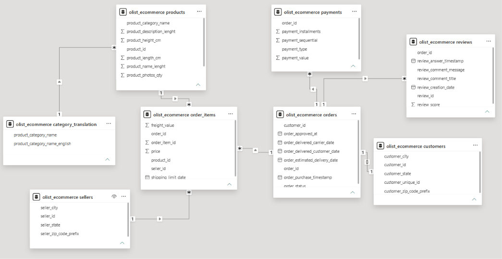

# Brazilian E-Commerce Sales & Customer Analytics using MySQL

## 1. Project Overview

This project analyses the Brazilian E-Commerce Public Dataset by Olist using MySQL 8.0.

The objective is to evaluate e-commerce sales performance, customer purchasing behaviour, product category performance, seller revenue, payment patterns, customer reviews, and delivery operations.

The project follows a practical SQL data analysis workflow, including data loading, data quality validation, database design, business analysis, and data-driven recommendations.

## 2. Business Objectives

- Analyse sales revenue and freight performance.
- Identify top-performing product categories and products.
- Understand customer spending and repeat purchasing behaviour.
- Evaluate seller revenue performance.
- Compare average order value across customer cities.
- Analyse payment methods and payment values.
- Monitor monthly revenue trends.
- Investigate customer satisfaction and delivery performance.

## 3. Dataset

**Dataset:** Brazilian E-Commerce Public Dataset by Olist

**Source:** [Kaggle – Brazilian E-Commerce Public Dataset by Olist](https://www.kaggle.com/datasets/olistbr/brazilian-ecommerce)

**Dataset period:** 2016–2018 (data ends on 17 October 2018).

The dataset contains information about customers, orders, order items, payments, products, sellers, reviews, and product categories.

### Database Tables

| Table | Records |
|---|---:|
| customers | 99,441 |
| orders | 99,441 |
| order_items | 112,650 |
| payments | 103,886 |
| products | 32,951 |
| sellers | 3,095 |
| reviews | 99,224 |
| category_translation | 71 |
| **Total** | **550,759** |

## 4. Tools & Technologies

- MySQL 8.0
- MySQL Workbench
- SQL
- Git and GitHub
- Power BI (data model preparation)

## 5. Data Loading & Data Quality Validation

### 5.1 Data Loading

During the initial data import using MySQL Table Data Import Wizard, discrepancies were identified between source CSV row counts and imported database table row counts.

To address this, I switched to MySQL's `LOAD DATA LOCAL INFILE` method to load the CSV datasets directly into their respective tables.

The final source-to-table row counts matched the supplied CSV extracts: customers 99,441; orders 99,441; order_items 112,650; payments 103,886; products 32,951; sellers 3,095; reviews 99,224; category_translation 71. This is **550,759 rows across eight tables**.

The loading process included:

- Creating tables with appropriate column data types.
- Importing CSV files using `LOAD DATA LOCAL INFILE`.
- Skipping CSV headers using `IGNORE 1 ROWS`.
- Using user variables to handle selected nullable fields.
- Converting empty strings into SQL NULL values using `NULLIF()`.
- Checking imported record counts using `COUNT(*)`.

### 5.2 NULL Validation

Checked 12 important identifier columns across the eight database tables using SQL `IS NULL` conditions.

**Result:** Zero NULL values were found in the selected identifier columns.

This validation was limited to selected identifier fields and does not imply that all columns are free of NULL values.

### 5.3 Duplicate Validation

Checked duplicate primary key and composite key groups across seven tables:

- customers
- orders
- products
- sellers
- order_items
- payments
- reviews

**Result:** No duplicate key groups were identified.

Composite key checks were performed for order items, payments, and reviews.

### 5.4 Referential Integrity Validation

Used SQL `LEFT JOIN` checks to identify orphan records across six major relationships:

- Orders → Customers
- Order Items → Orders
- Order Items → Products
- Order Items → Sellers
- Payments → Orders
- Reviews → Orders

**Result:** Zero orphan records were identified across the six tested relationships.

### 5.5 Product Category Mapping Validation

Compared product category values in the `products` table against the `category_translation` table.

The validation identified:

| Category issue | Product records |
|---|---:|
| Empty product category values | 610 |
| `pc_gamer` without translation | 3 |
| `portateis_cozinha_e_preparadores_de_alimentos` without translation | 10 |
| **Total affected product records** | **623** |

Two non-empty category values were missing from the translation table, affecting 13 products. In addition, 610 products contained empty category values. The validation query returned three unmatched values when the empty string was counted alongside the two named categories.

These records were identified during validation and were not automatically modified or deleted.

### 5.6 Correct Validation and Constraint Execution Order

For a clean rebuild, use this order:

1. Create the eight tables without primary-key and foreign-key constraints.
2. Load the CSV files using `LOAD DATA LOCAL INFILE`.
3. Run `queries/05_data_quality_validation.sql` to reconcile row counts and check NULLs, duplicates, orphan records and category mapping.
4. Investigate and document exceptions; do not automatically delete unmatched category records.
5. Run `queries/06_database_constraints.sql` to apply primary keys, composite keys and foreign keys.
6. Verify the resulting constraints using `INFORMATION_SCHEMA.KEY_COLUMN_USAGE`.

**Execution-history note:** In the initial project run, constraints were added before some of the NULL, duplicate and orphan checks were executed. Those original zero-result checks therefore describe the constrained database state; they are not evidence of a pre-constraint validation step. The sequence above is the corrected workflow for a fresh rebuild.

## 6. Database Design & Constraints

The database contains eight relational tables connected through primary and foreign key relationships.

- Implemented primary keys for individual tables.
- Created composite primary keys where required.
- Added foreign key constraints to maintain referential integrity.
- Reviewed unmatched product category values before establishing category relationships.

The product category translation relationship is maintained as a logical relationship rather than a foreign key because some product category values do not have matching translation records.

### Entity Relationship Diagram


## 7. SQL Analysis

The project contains 21 business questions organised into four sections.

### 7.1 Beginner Analysis (Q01–Q05)

SQL concepts: SELECT, WHERE, ORDER BY, LIMIT, aggregate functions.

- Q01: List customers from a specific city.
- Q02: Identify orders placed in the last 30 days of the dataset.
- Q03: Find the 10 most expensive products.
- Q04: Retrieve delivered orders and calculate their total count.
- Q05: Identify customers whose first recorded order was in 2017.

### 7.2 Intermediate Analysis (Q06–Q11)

SQL concepts: JOIN, GROUP BY, HAVING, aggregate functions, subqueries.

- Q06: Calculate total revenue and freight from delivered orders.
- Q07: Identify product categories with the highest units sold.
- Q08: Find the top five customers by total spending.
- Q09: Identify sellers generating more than R$10,000 in revenue.
- Q10: Calculate average order value by customer city.
- Q11: Analyse order counts and average payment values by payment type.

### 7.3 Advanced SQL Analysis (Q12–Q16)

SQL concepts: CTEs, window functions, subqueries, views, stored procedures.

- Q12: Rank products by revenue within each category.
- Q13: Identify customers spending more than the average customer.
- Q14: Identify repeat customers with more than two orders.
- Q15: Create a monthly sales summary view.
- Q16: Create a stored procedure to retrieve a customer's order history.

### 7.4 Additional Business Analysis (Q17–Q21)

- Q17: Identify customer cities generating the highest delivered item sales.
- Q18: Investigate orders without matching order items.
- Q19: Analyse month-over-month revenue growth using `LAG()`.
- Q20: Identify product categories with the lowest customer review scores.
- Q21: Calculate late delivery percentage and average delivery days.

### SQL Query Results & Execution Evidence

View [SQL Queries & Results](docs/SQL_Queries_and_Results.md) to read each business question, inspect its SQL query and see the corresponding result screenshot. The [screenshot-only gallery](screenshots/query_results/README.md) is also available.

## 8. Key Business Findings

The following findings were calculated from the Olist dataset using SQL.

### 8.1 Sales Performance

| Metric | Result |
|---|---:|
| Delivered item revenue | R$13,221,498.11 |
| Freight value | R$2,198,275.64 |
| Payments received on delivered orders | R$15,422,461.77 |

Payments on delivered orders total R$15,422,461.77, which is R$2,688.02 higher than delivered item revenue plus freight combined. This small reconciliation difference is documented for investigation rather than assumed to be an error.

### 8.2 Product Performance

- Bed, Bath & Table was the highest-selling category by units, with **10,953 units sold**.
- Health & Beauty generated the highest item revenue, approximately **R$1.23 million**.
- Watches & Gifts generated approximately **R$1.17 million** in item revenue.

### 8.3 Customer Analysis

- The five highest-spending customers were identified using `customer_unique_id`.
- **252 customers** placed more than two orders.
- The average delivered item spend per customer was approximately **R$141.62**.

### 8.4 Geographic Sales Performance

- São Paulo generated the highest delivered item sales, approximately **R$1.86 million**.
- Rio de Janeiro ranked second, generating approximately **R$955,573.97**.

### 8.5 Seller Performance

- **282 sellers** generated more than R$10,000 in delivered item revenue.
- The highest-revenue seller generated approximately **R$226,987.93**.

### 8.6 Customer Satisfaction

- Office Furniture had the lowest average review score among categories with at least 100 reviews, at approximately **3.65 out of 5**.

### 8.7 Delivery Performance

| Metric | Result |
|---|---:|
| Delivered orders with both delivery dates available | 96,470 |
| Late deliveries | 7,826 |
| Late delivery rate | 8.1% |
| Average delivery time | **12.5 days** |

### 8.8 Operational Finding

A total of **775 orders** had no matching order items:

- Unavailable: 603
- Canceled: 164
- Created: 5
- Invoiced: 2
- Shipped: 1

This demonstrates why order status and order-item records should be considered when analysing sales.

## 9. Power BI Data Modelling

The MySQL database was connected to Power BI to prepare and validate the relational data model.

### Detailed Project Report

The earlier Word export contained outdated numerical values and has been superseded. Use this README and [SQL Queries & Results](docs/SQL_Queries_and_Results.md) for the current corrected analysis. A corrected Word report is available separately and should replace the archived DOCX before sharing it from GitHub.



This provides a foundation for further dashboard development.

## 10. Business Recommendations

Based on the findings:

1. **Sales optimisation:** Prioritise inventory and promotional planning for high-volume categories such as Bed, Bath & Table.
2. **Revenue growth:** Investigate the strong revenue contribution from Health & Beauty and Watches & Gifts.
3. **Customer retention:** Develop loyalty campaigns for repeat and high-value customers.
4. **Seller management:** Study the performance of high-revenue sellers to identify practices that can be shared with other sellers.
5. **Customer satisfaction:** Investigate the causes of lower Office Furniture review scores and identify opportunities to improve product and service quality.
6. **Delivery improvement:** Investigate late deliveries and identify opportunities to improve logistics and estimated delivery accuracy.
7. **Order monitoring:** Monitor canceled and unavailable orders separately from completed sales.
8. **Data quality:** Review empty product category values and missing category translations to improve product classification.

## 11. Important Analysis Assumptions

- Revenue is calculated using item price from delivered orders.
- Freight value is reported separately from item revenue.
- Customer identity is analysed using `customer_unique_id`, because `customer_id` is associated with individual orders.
- The dataset does not provide a customer signup date. First recorded order date is used as a proxy where required.
- Delivery performance excludes delivered orders with missing actual or estimated delivery dates.
- NULL validation covers selected identifier columns, not every column.
- Duplicate validation covers the selected primary and composite key combinations.
- The dataset is historical and ends on 17 October 2018. Results should not be interpreted as current market performance.

## 12. Repository Structure

```text
olist-ecommerce-sql-analytics/
│
├── queries/
│   ├── 01_beginner_queries.sql
│   ├── 02_intermediate_queries.sql
│   ├── 03_advanced_queries.sql
│   ├── 04_business_analysis_queries.sql
│   ├── 05_data_quality_validation.sql
│   └── 06_database_constraints.sql
│
├── screenshots/
│   ├── powerbi_datamodeling.png
│   └── query_results/
│       ├── README.md
│       └── Q01–Q21 execution screenshots
│
├── er-diagram/
│   └── ER Diagram.png
│
├── docs/
│   └── Olist_Ecommerce_Final_Report.docx
│
├── README.md
└── dataset_source.md
```

## 13. Author

**Akash PV**

GitHub: [akash-pv](https://github.com/akash-pv)

---

*This project demonstrates practical SQL skills, data loading, data quality validation, relational database design, analytical querying and business-focused problem solving using a real-world e-commerce dataset.*
