# Olist SQL Queries & Results

This document presents each business question in the same sequence: the question, the SQL used, and the corresponding MySQL Workbench result screenshot.

The SQL is taken from the project's query files. Screenshots are linked from `screenshots/query_results/`. The complete scripts are available in the [queries folder](../queries/).

**Analysis convention:** Revenue uses delivered orders only and sums item price. Freight is reported separately unless stated otherwise.

---

## 1. Beginner Analysis

## Q01 – Customers from São Paulo

**Business question:** Which customers are recorded in São Paulo?

**SQL query**

```sql
-- Q01: List customers from Sao Paulo.
SELECT
    customer_unique_id,
    customer_city,
    customer_state
FROM customers
WHERE customer_city = 'sao paulo'
LIMIT 20;
```

**MySQL Workbench result**

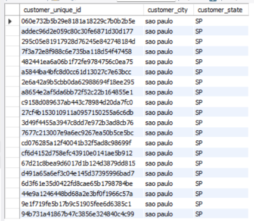

## Q02 – Orders in the final 30 days

**Business question:** Which orders were placed during the final 30 days of the dataset, ending 17 October 2018?

**SQL query**

```sql
-- Q02: Orders placed during the final 30 days of the dataset.
-- Dataset end date: 2018-10-17.
-- The final period contains a high proportion of canceled orders.
SELECT
    order_id,
    order_status,
    order_purchase_timestamp
FROM orders
WHERE order_purchase_timestamp >= DATE_SUB(
          '2018-10-17', INTERVAL 30 DAY
      )
  AND order_purchase_timestamp < '2018-10-18'
ORDER BY order_purchase_timestamp DESC;
```

**MySQL Workbench result**

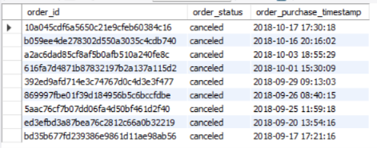

> The query uses an inclusive start date and an exclusive end date to include the full final day.

## Q03 – Top 10 products by highest recorded item price

**Business question:** Which products have the highest recorded item price?

**SQL query**

```sql
-- Q03: Top 10 products by highest recorded item price.
-- Uses MAX(price) to identify the highest recorded price
-- for each product.
SELECT
    product_id,
    MAX(price) AS highest_price
FROM order_items
GROUP BY product_id
ORDER BY highest_price DESC
LIMIT 10;
```

**MySQL Workbench result**

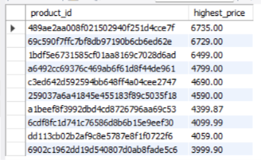

> MAX(price) returns the highest recorded item price per product; it is not average price or total product revenue.

## Q04 – Delivered orders

**Business question:** What do delivered orders look like, and how many delivered orders are there?

**SQL query**

```sql
-- Q04: Display the first 20 delivered orders.
-- Ordered by purchase timestamp for consistent results.
SELECT
    order_id,
    customer_id,
    order_purchase_timestamp
FROM orders
WHERE order_status = 'delivered'
ORDER BY order_purchase_timestamp ASC
LIMIT 20;


-- Q04 Additional Metric: Total number of delivered orders.
SELECT
    COUNT(*) AS delivered_orders
FROM orders
WHERE order_status = 'delivered';
```

**MySQL Workbench results**

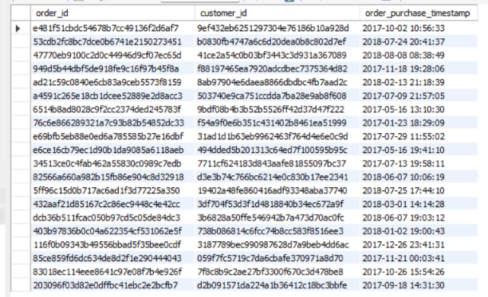

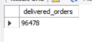

## Q05 – Customers whose first recorded order was in 2017

**Business question:** Which customers made their first recorded purchase during 2017?

**SQL query**

```sql
-- Q05: Identify customers whose first recorded order
-- occurred in 2017.
-- The dataset does not contain a customer signup date.
-- Therefore, first order date is used as a proxy.
-- customer_unique_id identifies customers across orders.
SELECT
    c.customer_unique_id,
    MIN(o.order_purchase_timestamp) AS first_order
FROM customers c
JOIN orders o
    ON c.customer_id = o.customer_id
GROUP BY c.customer_unique_id
HAVING YEAR(MIN(o.order_purchase_timestamp)) = 2017
ORDER BY first_order
LIMIT 20;
```

**MySQL Workbench result**

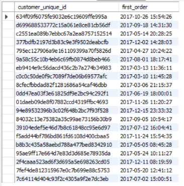

> The dataset does not contain a customer signup date. First order date is used as a proxy, not as an actual registration date.

---

## 2. Intermediate Analysis

## Q06 – Delivered revenue and freight

**Business question:** What were delivered item revenue and freight charges?

**SQL query**

```sql
-- Q06: Total item revenue and freight generated by delivered orders.
SELECT
    SUM(oi.price) AS total_revenue,
    SUM(oi.freight_value) AS total_freight
FROM orders o
JOIN order_items oi
    ON o.order_id = oi.order_id
WHERE o.order_status = 'delivered';

-- Q06 validation: payments received for delivered orders.
-- This may differ slightly from item revenue + freight due to dataset/payment details.
SELECT
    SUM(p.payment_value) AS total_paid
FROM orders o
JOIN payments p
    ON o.order_id = p.order_id
WHERE o.order_status = 'delivered';
```

**MySQL Workbench results**

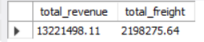

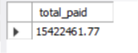

> The payment total is a separate reconciliation measure and should not automatically be treated as equal to item revenue plus freight.

## Q07 – Top product categories by units sold

**Business question:** Which product categories sold the highest number of units in delivered orders?

**SQL query**

```sql
-- Q07: Product categories with the highest number of units sold.
SELECT
    COALESCE(
        t.product_category_name_english,
        NULLIF(p.product_category_name, ''),
        'unknown'
    ) AS category,
    COUNT(*) AS units_sold
FROM order_items oi
JOIN orders o
    ON oi.order_id = o.order_id
JOIN products p
    ON oi.product_id = p.product_id
LEFT JOIN category_translation t
    ON p.product_category_name = t.product_category_name
WHERE o.order_status = 'delivered'
GROUP BY category
ORDER BY units_sold DESC
LIMIT 10;
```

**MySQL Workbench result**

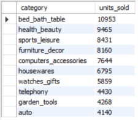

> COALESCE and NULLIF provide readable category labels when a translation is missing or the source category is empty.

## Q08 – Top five customers by delivered item spend

**Business question:** Which five customers spent the most on delivered items?

**SQL query**

```sql
-- Q08: Top 5 customers by total item spend on delivered orders.
SELECT
    c.customer_unique_id,
    SUM(oi.price) AS total_spent
FROM customers c
JOIN orders o
    ON c.customer_id = o.customer_id
JOIN order_items oi
    ON o.order_id = oi.order_id
WHERE o.order_status = 'delivered'
GROUP BY c.customer_unique_id
ORDER BY total_spent DESC
LIMIT 5;
```

**MySQL Workbench result**

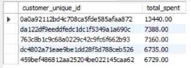

> customer_unique_id groups orders belonging to the same customer across order-specific customer_id values.

## Q09 – Sellers with delivered item revenue above R$10,000

**Business question:** Which sellers generated more than R$10,000 in delivered item revenue?

**SQL query**

```sql
-- Q09: Sellers who generated more than R$10,000 in delivered item revenue.
SELECT
    s.seller_id,
    s.seller_city,
    SUM(oi.price) AS total_revenue
FROM sellers s
JOIN order_items oi
    ON s.seller_id = oi.seller_id
JOIN orders o
    ON oi.order_id = o.order_id
WHERE o.order_status = 'delivered'
GROUP BY s.seller_id, s.seller_city
HAVING SUM(oi.price) > 10000
ORDER BY total_revenue DESC;
```

**Execution screenshot:** Not included in this gallery. Capture a fresh result directly from MySQL Workbench before adding Q09 evidence.

> The SQL is included, but the screenshot is intentionally omitted because the earlier captured seller output and the later count check did not provide matching evidence. Re-run this query in MySQL Workbench and add its genuine output screenshot when verified.

## Q10 – Average order value by customer city

**Business question:** Which customer cities have the highest average delivered order value, considering cities with at least 50 delivered orders?

**SQL query**

```sql
-- Q10: Average order value by customer city (cities with 50+ delivered orders).
-- AOV here is based on item price only; freight is excluded.
-- First aggregate to one row per order, then calculate the city average.
SELECT
    city,
    ROUND(AVG(order_value), 2) AS avg_order_value,
    COUNT(*) AS orders
FROM (
    SELECT
        c.customer_city AS city,
        o.order_id,
        SUM(oi.price) AS order_value
    FROM customers c
    JOIN orders o
        ON c.customer_id = o.customer_id
    JOIN order_items oi
        ON o.order_id = oi.order_id
    WHERE o.order_status = 'delivered'
    GROUP BY c.customer_city, o.order_id
) AS order_totals
GROUP BY city
HAVING COUNT(*) >= 50
ORDER BY avg_order_value DESC
LIMIT 10;
```

**MySQL Workbench result**

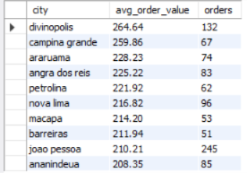

> The inner query calculates one item-price total per order. The outer query averages those order totals by city, avoiding item-row weighting.

## Q11 – Payment type analysis

**Business question:** How many delivered orders were handled by each payment type, and what was the average payment value?

**SQL query**

```sql
-- Q11: Number of orders handled and average payment value per payment type.
-- Payment instalments are summed per order/payment type before averaging.
SELECT
    payment_type,
    COUNT(*) AS orders_handled,
    ROUND(AVG(order_payment), 2) AS avg_payment_value
FROM (
    SELECT
        p.order_id,
        p.payment_type,
        SUM(p.payment_value) AS order_payment
    FROM payments p
    JOIN orders o
        ON p.order_id = o.order_id
    WHERE o.order_status = 'delivered'
    GROUP BY p.order_id, p.payment_type
) AS payment_summary
GROUP BY payment_type
ORDER BY orders_handled DESC;
```

**MySQL Workbench result**

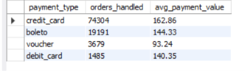

> Payment instalments are aggregated at order and payment-type level before averages are calculated.

---

## 3. Advanced SQL Analysis

## Q12 – Top three products by revenue within each category

**Business question:** Which products rank in the top three by delivered item revenue within each category?

**SQL query**

```sql
-- Q12: Rank products by revenue within each category (top 3 per category).
-- No global LIMIT is used, so all categories can return their top-ranked products.
WITH product_revenue AS (
    SELECT
        COALESCE(
            t.product_category_name_english,
            NULLIF(p.product_category_name, ''),
            'unknown'
        ) AS category,
        oi.product_id,
        SUM(oi.price) AS revenue
    FROM order_items oi
    JOIN orders o
        ON oi.order_id = o.order_id
    JOIN products p
        ON oi.product_id = p.product_id
    LEFT JOIN category_translation t
        ON p.product_category_name = t.product_category_name
    WHERE o.order_status = 'delivered'
    GROUP BY category, oi.product_id
),
ranked AS (
    SELECT
        category,
        product_id,
        revenue,
        RANK() OVER (
            PARTITION BY category
            ORDER BY revenue DESC
        ) AS rnk
    FROM product_revenue
)
SELECT
    category,
    product_id,
    revenue,
    rnk
FROM ranked
WHERE rnk <= 3
ORDER BY category, rnk, revenue DESC;
```

**MySQL Workbench result**

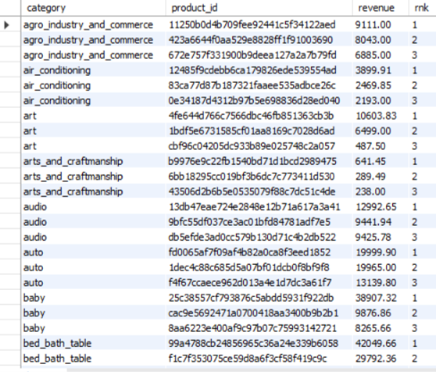

> A CTE calculates product revenue, then RANK() assigns rankings within each category using PARTITION BY.

## Q13 – Customers spending above the average

**Business question:** Which customers have delivered item spend above the average customer spend?

**SQL query**

```sql
-- Q13: Customers whose delivered item spend is above the average customer spend.
SELECT
    c.customer_unique_id,
    SUM(oi.price) AS total_spent
FROM customers c
JOIN orders o
    ON c.customer_id = o.customer_id
JOIN order_items oi
    ON o.order_id = oi.order_id
WHERE o.order_status = 'delivered'
GROUP BY c.customer_unique_id
HAVING SUM(oi.price) > (
    SELECT AVG(customer_total)
    FROM (
        SELECT
            SUM(oi2.price) AS customer_total
        FROM customers c2
        JOIN orders o2
            ON c2.customer_id = o2.customer_id
        JOIN order_items oi2
            ON o2.order_id = oi2.order_id
        WHERE o2.order_status = 'delivered'
        GROUP BY c2.customer_unique_id
    ) AS customer_totals
)
ORDER BY total_spent DESC
LIMIT 20;
```

**MySQL Workbench result**

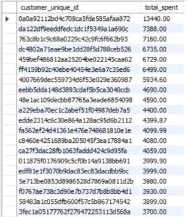

> The subquery calculates each customer's total spend, then averages those totals for comparison.

## Q14 – Repeat customers

**Business question:** Which customers placed more than two orders, and does anyone exceed 20 orders?

**SQL query**

```sql
-- Q14: Repeat customers with more than 2 orders.
-- customer_unique_id is used to identify the same customer across order-specific customer_id values.
SELECT
    c.customer_unique_id,
    COUNT(DISTINCT o.order_id) AS orders_placed
FROM customers c
JOIN orders o
    ON c.customer_id = o.customer_id
GROUP BY c.customer_unique_id
HAVING COUNT(DISTINCT o.order_id) > 2
ORDER BY orders_placed DESC;

-- Q14 validation: the original guide's threshold of more than 20 orders.
-- This may return no rows in this dataset.
SELECT
    c.customer_unique_id,
    COUNT(DISTINCT o.order_id) AS orders_placed
FROM customers c
JOIN orders o
    ON c.customer_id = o.customer_id
GROUP BY c.customer_unique_id
HAVING COUNT(DISTINCT o.order_id) > 20;
```

**MySQL Workbench results**

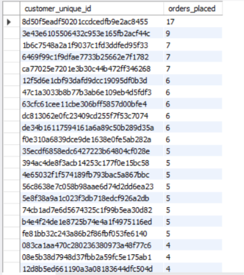

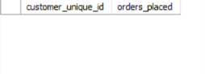

> The >2 threshold identifies repeat customers. The >20 query is a separate threshold validation.

## Q15 – Monthly sales summary view

**Business question:** Can monthly delivered sales metrics be stored in a reusable SQL view?

**SQL query**

```sql
-- Q15: Create a reusable monthly sales summary view.
-- Run this CREATE VIEW statement once, then run the SELECT below it.
CREATE OR REPLACE VIEW monthly_sales_summary AS
SELECT
    DATE_FORMAT(o.order_purchase_timestamp, '%Y-%m') AS order_month,
    COUNT(DISTINCT o.order_id) AS orders,
    SUM(oi.price) AS revenue,
    SUM(oi.freight_value) AS freight,
    ROUND(SUM(oi.price) / COUNT(DISTINCT o.order_id), 2) AS avg_order_value
FROM orders o
JOIN order_items oi
    ON o.order_id = oi.order_id
WHERE o.order_status = 'delivered'
GROUP BY DATE_FORMAT(o.order_purchase_timestamp, '%Y-%m');

-- Q15: Query the view.
SELECT *
FROM monthly_sales_summary
ORDER BY order_month;
```

**MySQL Workbench result**

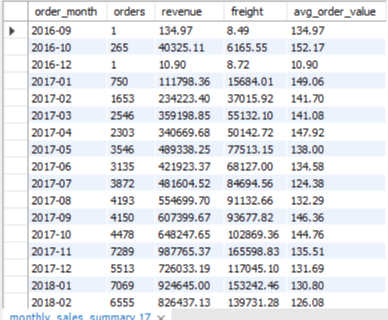

> Run the CREATE OR REPLACE VIEW statement once, then query the view using the SELECT statement included in the SQL block.

## Q16 – Customer order history stored procedure

**Business question:** Can a stored procedure return order history for a selected customer?

**SQL query**

```sql
-- Q16: Create a stored procedure for one customer's order history.
-- Execute the complete DROP/DELIMITER/CREATE block together in MySQL Workbench.
DROP PROCEDURE IF EXISTS get_customer_history;

DELIMITER //

CREATE PROCEDURE get_customer_history(IN p_customer_unique_id VARCHAR(50))
BEGIN
    SELECT
        o.order_id,
        o.order_status,
        o.order_purchase_timestamp,
        COUNT(oi.order_item_id) AS items,
        COALESCE(SUM(oi.price), 0) AS order_value
    FROM customers c
    JOIN orders o
        ON c.customer_id = o.customer_id
    LEFT JOIN order_items oi
        ON o.order_id = oi.order_id
    WHERE c.customer_unique_id = p_customer_unique_id
    GROUP BY
        o.order_id,
        o.order_status,
        o.order_purchase_timestamp
    ORDER BY o.order_purchase_timestamp;
END //

DELIMITER ;

-- Q16: After creating the procedure, replace the placeholder below with
-- a real customer_unique_id from the Q14 result, then execute the CALL.
-- CALL get_customer_history('paste_a_customer_unique_id_here');
```

**MySQL Workbench result**

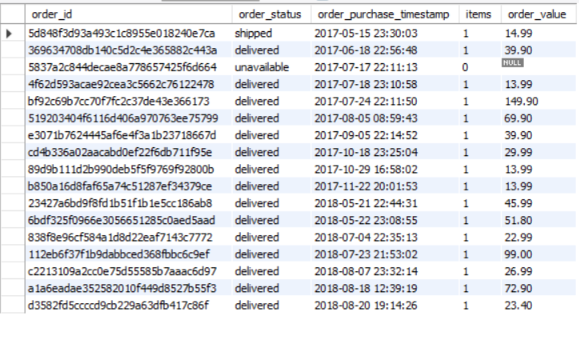

> Create the procedure first. Replace the placeholder customer_unique_id in the CALL example with a real ID before executing it.

---

## 4. Additional Business Analysis

## Q17 – Cities with the highest delivered item sales

**Business question:** Which customer cities generated the highest delivered item sales?

**SQL query**

```sql
-- Q17: Customer cities generating the highest delivered item sales.
SELECT
    c.customer_city,
    SUM(oi.price) AS total_price
FROM customers c
JOIN orders o
    ON c.customer_id = o.customer_id
JOIN order_items oi
    ON o.order_id = oi.order_id
WHERE o.order_status = 'delivered'
GROUP BY c.customer_city
ORDER BY total_price DESC
LIMIT 10;
```

**MySQL Workbench result**

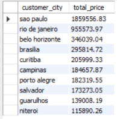

## Q18 – Orders without matching order items

**Business question:** How many orders have no matching order_items records, and what are their statuses?

**SQL query**

```sql
-- Q18: Investigate orders that have no matching order_items records.
-- This helps explain why an INNER JOIN can exclude some orders.
SELECT
    o.order_status,
    COUNT(*) AS orders_without_items
FROM orders o
LEFT JOIN order_items oi
    ON o.order_id = oi.order_id
WHERE oi.order_id IS NULL
GROUP BY o.order_status
ORDER BY orders_without_items DESC;
```

**MySQL Workbench result**

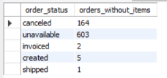

> A LEFT JOIN keeps all orders; filtering for a NULL child key identifies orders without matching order items.

## Q19 – Month-over-month revenue growth

**Business question:** How did delivered item revenue change from month to month?

**SQL query**

```sql
-- Q19: Month-over-month revenue growth using LAG().
-- Requires the monthly_sales_summary view created in Q15.
SELECT
    order_month,
    revenue,
    LAG(revenue) OVER (ORDER BY order_month) AS previous_month_revenue,
    ROUND(
        (
            revenue - LAG(revenue) OVER (ORDER BY order_month)
        ) / NULLIF(LAG(revenue) OVER (ORDER BY order_month), 0) * 100,
        1
    ) AS growth_pct
FROM monthly_sales_summary
ORDER BY order_month;
```

**MySQL Workbench result**

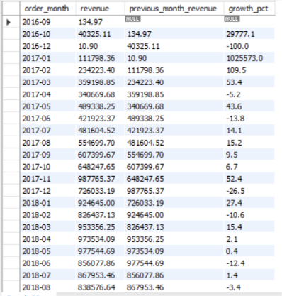

> LAG() retrieves the previous month's revenue for comparison.

## Q20 – Lowest category review scores

**Business question:** Which product categories have the lowest average review scores, among categories with at least 100 reviews?

**SQL query**

```sql
-- Q20: Product categories with the lowest average review scores.
-- Only delivered orders are included; each review is counted once per category.
-- A review may appear in more than one category if its order contains products
-- from multiple categories.
SELECT
    category,
    ROUND(AVG(review_score), 2) AS avg_review_score,
    COUNT(*) AS reviews
FROM (
    SELECT DISTINCT
        r.review_id,
        r.review_score,
        COALESCE(
            t.product_category_name_english,
            NULLIF(p.product_category_name, ''),
            'unknown'
        ) AS category
    FROM orders o
    JOIN reviews r
        ON o.order_id = r.order_id
    JOIN order_items oi
        ON o.order_id = oi.order_id
    JOIN products p
        ON oi.product_id = p.product_id
    LEFT JOIN category_translation t
        ON p.product_category_name = t.product_category_name
    WHERE o.order_status = 'delivered'
) AS category_reviews
GROUP BY category
HAVING COUNT(*) >= 100
ORDER BY avg_review_score ASC
LIMIT 10;
```

**MySQL Workbench result**

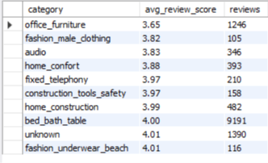

> A review can be associated with more than one category when an order contains products from different categories.

## Q21 – Delivery performance

**Business question:** What percentage of delivered orders arrived late, and what was the average delivery time?

**SQL query**

```sql
-- Q21: Delivered orders arriving later than the estimated delivery date.
-- Rows with missing actual or estimated delivery dates are excluded.
SELECT
    COUNT(*) AS delivered_orders,
    SUM(
        order_delivered_customer_date > order_estimated_delivery_date
    ) AS late_orders,
    ROUND(
        100 * SUM(
            order_delivered_customer_date > order_estimated_delivery_date
        ) / COUNT(*),
        1
    ) AS late_pct,
    ROUND(
        AVG(
            DATEDIFF(
                order_delivered_customer_date,
                order_purchase_timestamp
            )
        ),
        1
    ) AS avg_delivery_days
FROM orders
WHERE order_status = 'delivered'
  AND order_delivered_customer_date IS NOT NULL
  AND order_estimated_delivery_date IS NOT NULL;
```

**MySQL Workbench result**

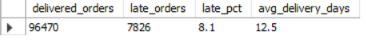

> The query excludes delivered orders missing either the actual or estimated customer-delivery date.

---

## Related project files

- [Beginner SQL queries](../queries/01_beginner_queries.sql)
- [Intermediate SQL queries](../queries/02_intermediate_queries.sql)
- [Advanced SQL queries](../queries/03_advanced_queries.sql)
- [Business analysis queries](../queries/04_business_analysis_queries.sql)
- [Database constraints](../queries/05_database_constraints.sql)
- [Data-quality validation](../queries/06_data_quality_validation.sql)
- [Screenshot-only gallery](../screenshots/query_results/README.md)
- [Main project README](../README.md)

*The screenshots are captured evidence from the project report. Q09 is left without an image until a matching result can be captured directly from MySQL Workbench.*
