# Olist SQL Query Result Screenshots

Execution-result screenshots extracted from `Olist_Ecommerce_Final_Report.docx`.

Use the corresponding `.sql` files in the repository `queries/` folder to inspect the SQL code. These images show the captured MySQL Workbench outputs from the report; they are not newly re-executed screenshots.

| Question | Result description | Screenshot file |
|---|---|---|
| Q01 | Customers from Sao Paulo | `Q01_customers_sao_paulo.png` |
| Q02 | Orders in the final 30 days of the dataset | `Q02_orders_final_30_days.png` |
| Q03 | Top 10 products by highest recorded item price | `Q03_top_10_product_prices.png` |
| Q04 | Delivered orders | `Q04_delivered_orders_sample.png` |
| Q04 | Total delivered order count | `Q04_delivered_orders_count.png` |
| Q05 | Customers whose first recorded order was in 2017 | `Q05_customers_first_order_2017.png` |
| Q06 | Delivered item revenue and freight | `Q06_delivered_revenue_and_freight.png` |
| Q06 | Payments associated with delivered orders | `Q06_payments_delivered_orders.png` |
| Q07 | Top product categories by units sold | `Q07_top_product_categories.png` |
| Q08 | Top five customers by delivered item spend | `Q08_top_5_customers_by_spend.png` |
| Q09 | Count validation: 282 sellers with more than R$10,000 delivered item revenue | `Q09_seller_count_validation_summary.png` |
| Q10 | Average order value by customer city | `Q10_average_order_value_by_city.png` |
| Q11 | Orders handled and average payment by payment type | `Q11_payment_type_analysis.png` |
| Q12 | Top three products by revenue within each category | `Q12_top_products_by_category.png` |
| Q13 | Customers spending above the average customer | `Q13_customers_above_average_spend.png` |
| Q14 | Customers with more than two orders | `Q14_repeat_customers_more_than_2_orders.png` |
| Q14 | Validation showing no customers above 20 orders | `Q14_validation_more_than_20_orders.png` |
| Q15 | Monthly sales summary view output | `Q15_monthly_sales_summary_view.png` |
| Q16 | Stored procedure output for one customer | `Q16_customer_order_history_procedure.png` |
| Q17 | Customer cities with highest delivered item sales | `Q17_top_cities_by_delivered_sales.png` |
| Q18 | Orders without matching order items by status | `Q18_orders_without_order_items.png` |
| Q19 | Monthly revenue and previous-month growth | `Q19_month_over_month_revenue_growth.png` |
| Q20 | Product categories with lowest average review scores | `Q20_lowest_category_review_scores.png` |
| Q21 | Late delivery rate and average delivery days | `Q21_delivery_performance.png` |

---

# Visual Results

## Q01 – Customers from Sao Paulo

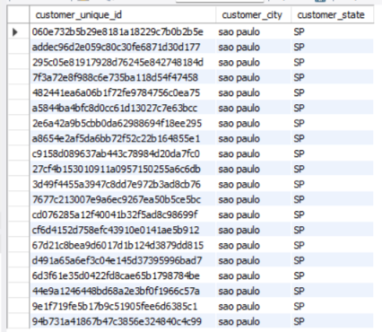

## Q02 – Orders in the final 30 days of the dataset

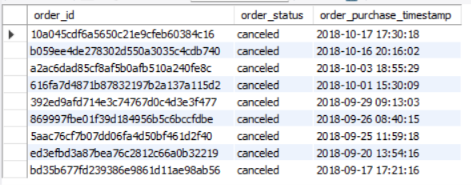

## Q03 – Top 10 products by highest recorded item price

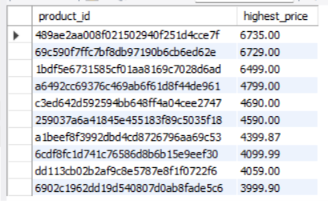

## Q04 – Delivered orders

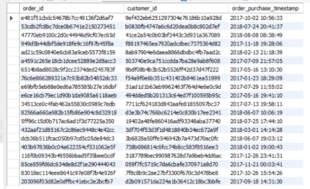

## Q04 – Total delivered order count

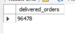

## Q05 – Customers whose first recorded order was in 2017

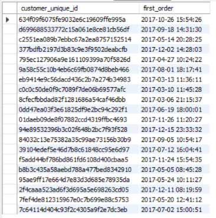

## Q06 – Delivered item revenue and freight

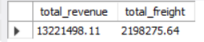

## Q06 – Payments associated with delivered orders

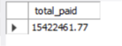

## Q07 – Top product categories by units sold

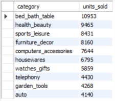

## Q08 – Top five customers by delivered item spend

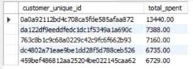

## Q10 – Average order value by customer city

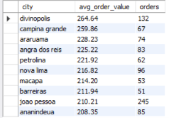

## Q11 – Orders handled and average payment by payment type

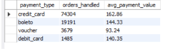

## Q12 – Top three products by revenue within each category

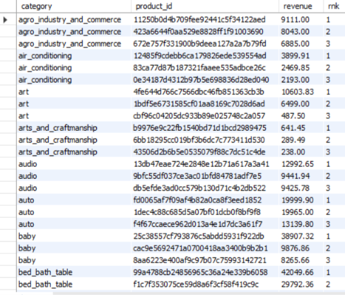

## Q13 – Customers spending above the average customer

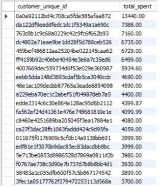

## Q14 – Customers with more than two orders

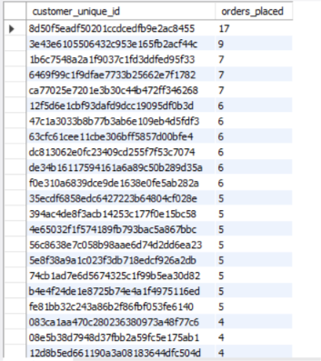

## Q14 – Validation showing no customers above 20 orders

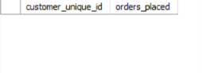

## Q15 – Monthly sales summary view output

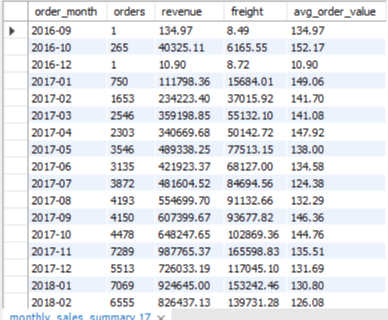

## Q16 – Stored procedure output for one customer

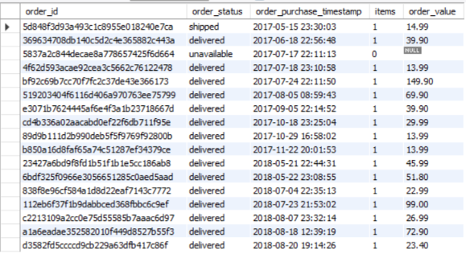

## Q17 – Customer cities with highest delivered item sales

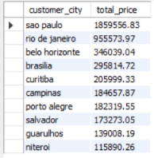

## Q18 – Orders without matching order items by status

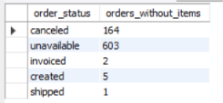

## Q19 – Monthly revenue and previous-month growth

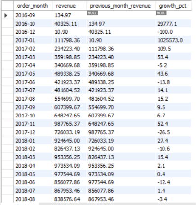

## Q20 – Product categories with lowest average review scores

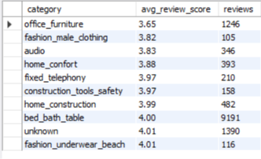

## Q21 – Late delivery rate and average delivery days

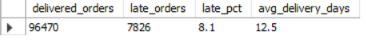

## Notes

- Q04 includes both a delivered-order sample and the total delivered-order count.
- Q06 includes revenue/freight and payment-total screenshots.
- Q14 includes the repeat-customer result (>2 orders) and a separate validation of the >20-order threshold.
- The report contains 24 embedded result images for Q01–Q21. The repeated questions above have more than one screenshot.
